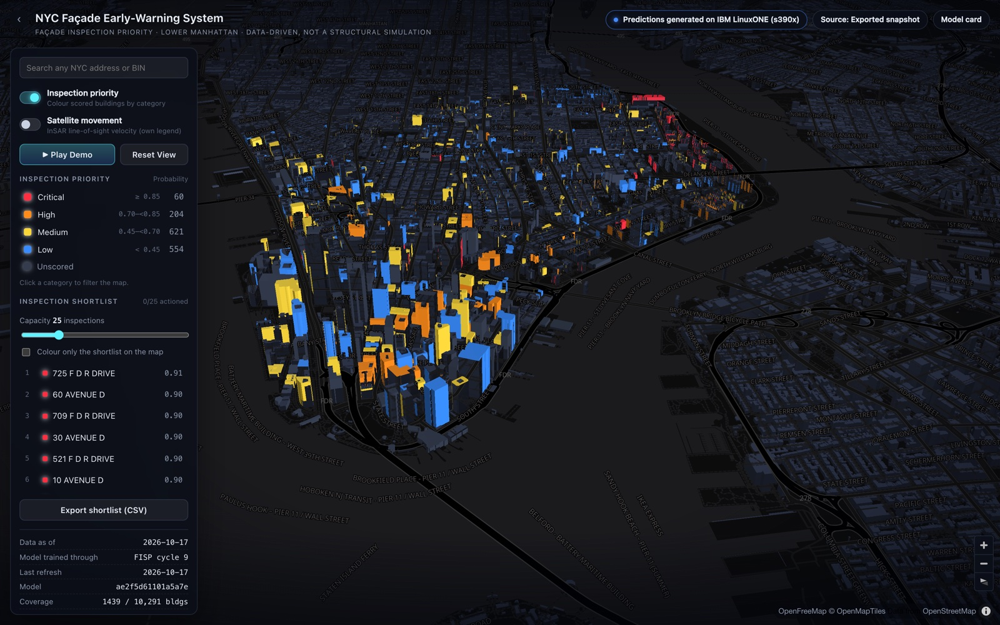
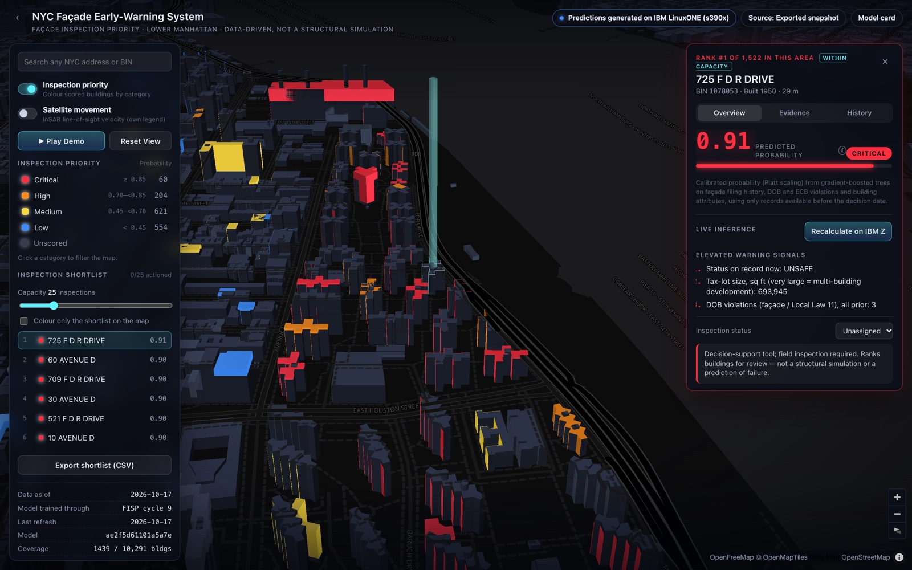
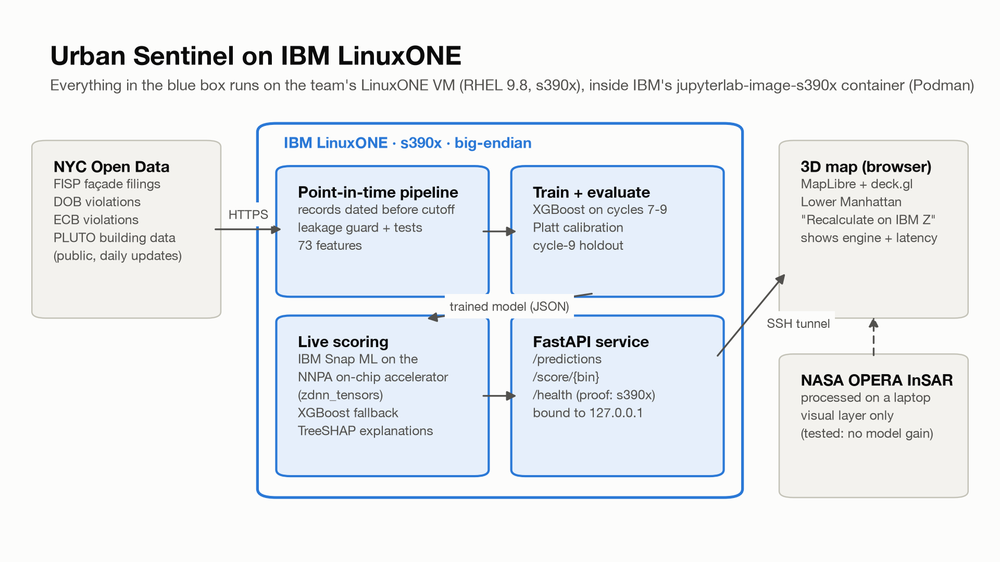
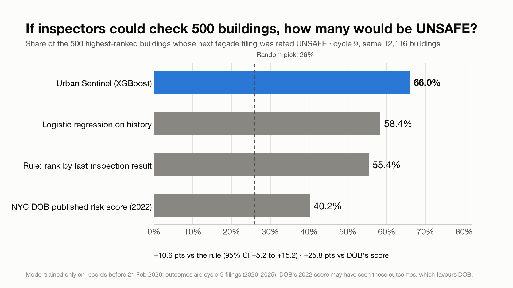
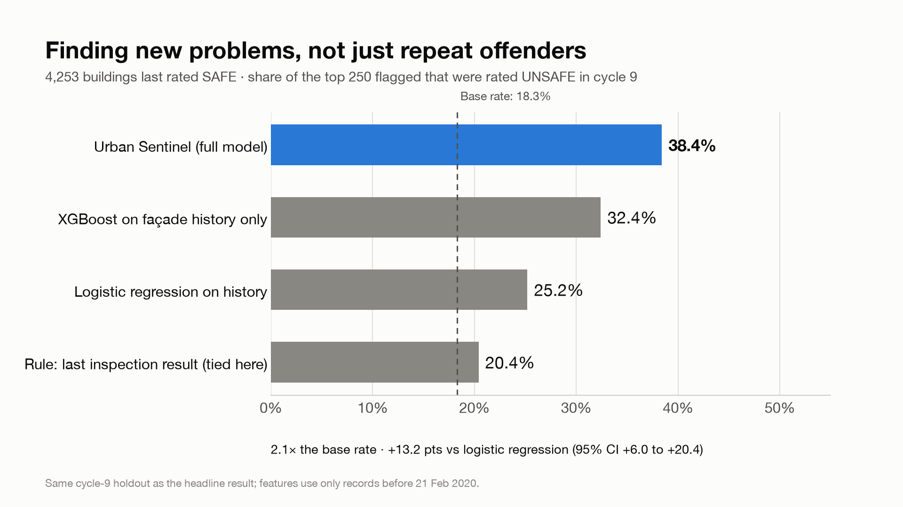
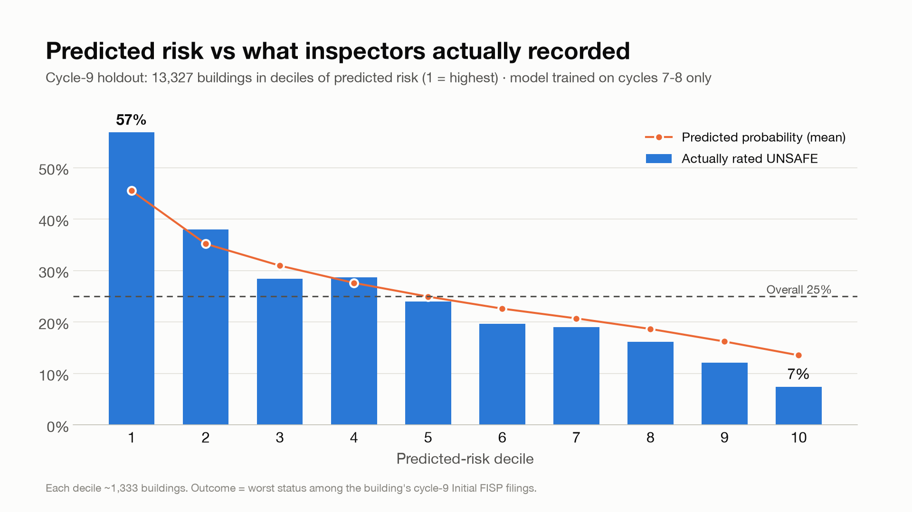
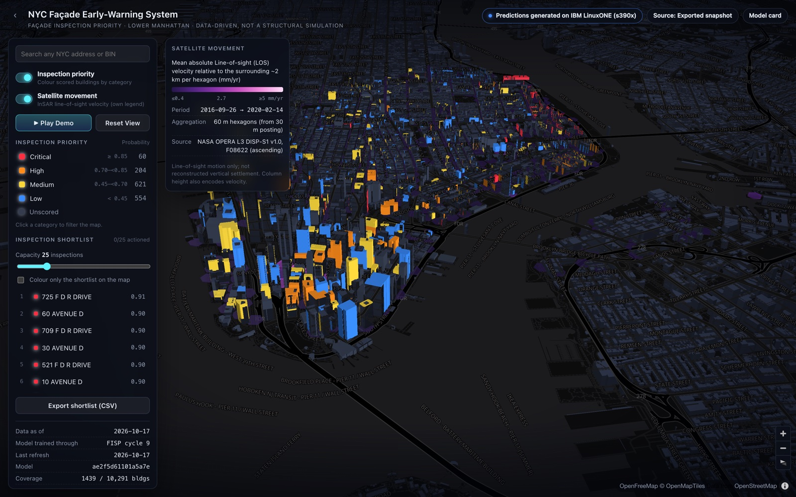
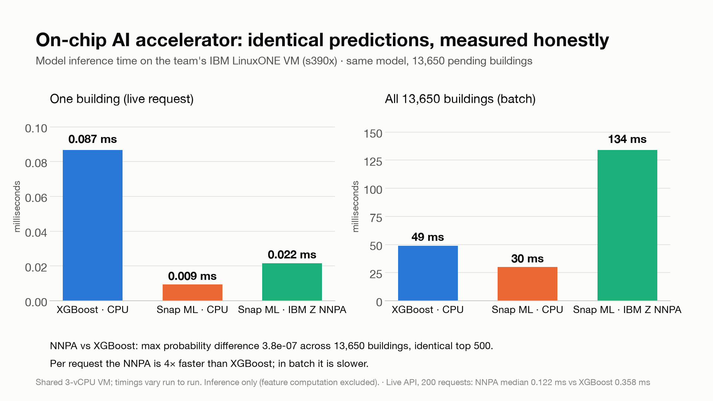

# Urban Sentinel

**Early warning for façade inspection in New York City. Machine learning trained and served on IBM LinuxONE, with live predictions running on the IBM Z on-chip AI accelerator.**

IBM Z Datathon 2026 · Track: **Real-Time AI for Critical Decisions** · Team **Megatronn**: Kason Lin, Jayden Lee, Aaron Munford, Tina Tran



---

## In 30 seconds

- **The problem.** New York's tall buildings (more than six stories) only get a mandatory façade inspection **once every five years**. In between, the city mostly learns about problems from complaints, often after something has already fallen.
- **What we built.** Urban Sentinel ranks every building by the **probability that its next mandated inspection will find an UNSAFE façade**. Inspectors can go first where it matters. It runs as an interactive 3D map with the reasons behind each score.
- **Does it work?** We tested it on inspections from 2020–2025 that the model never saw. Of the **500 buildings it would have flagged first, 66% were later rated UNSAFE**. That compares with **55%** when ranking by each building's last inspection result, **40%** for NYC Department of Buildings' own published risk score, and **26%** for a random pick. These figures are on the 12,116 buildings all methods share.
- **IBM Z.** The pipeline is **trained, evaluated and served on IBM LinuxONE (s390x)**. Live predictions run on the **Telum on-chip AI accelerator (NNPA) through IBM Snap ML**, verified to match the reference model to within 3×10⁻⁷.

---

## 1. The problem

Infrastructure failures are expensive, and the cost lands on ordinary people:

- **$391–647 billion a year** in disruption costs to households and firms in low- and middle-income countries ([World Bank, *Lifelines*, 2019](https://blogs.worldbank.org/en/climatechange/pipes-prosperity-resilient-infrastructure-opportunity)).
- **$668 million a year (1.8% of GDP)** in losses to firms in a single economy, Tanzania (same report).
- **$3,300 per US household per year**, and **$10 trillion in lost US GDP over two decades**, if infrastructure investment stays where it is ([ASCE, *Failure to Act*, 2021](https://www.asce.org/publications-and-news/civil-engineering-source/society-news/article/2021/01/12/deteriorating-infrastructure-and-growing-investment-gap-will-reduce-us-gdp)).

**Building façades are where this becomes a street-level safety issue.** NYC's Local Law 11, the **Façade Inspection & Safety Program (FISP)**, requires every building taller than six stories to file a licensed inspection every five years. In each cycle about **13,000 buildings** file, and **roughly 1 in 4 initial reports is rated UNSAFE**. Between cycles, the city learns about problems mainly from complaints and violations, which is reactive.

In December 2019, architect Erica Tishman was killed by façade debris falling from 729 Seventh Avenue. The building had an open façade violation from April that year ([Commercial Observer](https://commercialobserver.com/2019/12/729-seventh-avenue-erica-tishman-construction-death/)). Inspector time is limited, so **the critical decision is which buildings to look at first.**

## 2. Our solution

| Before: reactive | After: Urban Sentinel |
|---|---|
| A façade is inspected once every 5 years, on a fixed schedule | Every building gets a **risk score**, refreshed as new city records arrive |
| Problems surface through complaints, often after damage is visible | A **ranked inspection shortlist** sized to the inspectors' capacity |
| No view of which of ~13,000 buildings is most likely to fail next | **Reasons** for each score: past ratings, violations, building traits |
| Decisions made building by building | A **3D city map** for planning, with search and building history |

**Key features**

| | |
|---|---|
| **Risk map** | 3D Lower Manhattan, 1,522 scored buildings coloured by predicted risk (Critical / High / Medium / Low) |
| **Inspection shortlist** | Top-N list for a chosen capacity, exportable to CSV |
| **Recalculate on IBM Z** | Re-scores a building live on LinuxONE and shows the engine (NNPA or CPU), probability and latency |
| **Why this building?** | Top factors behind each score (TreeSHAP explanations) in plain language |
| **Satellite ground motion** | Measured NASA OPERA InSAR ground movement as context. Shown as its own layer, not used by the model (see Results) |
| **Search and history** | Look up any NYC address or BIN and see its inspection and violation record (history comes from the live API) |



## 3. How it works

<picture>
  <source media="(prefers-color-scheme: dark)" srcset="ml/reports/figures/architecture_dark.png">
  
</picture>

1. **Ingest.** Public records are pulled from NYC Open Data and cached with provenance (dataset id, fetch time).
2. **Point-in-time features.** For each building we compute 73 features using **only records dated before the decision date**:
   - façade history: past ratings, repairs, late or missed filings;
   - DOB façade and structural violations back to 1998;
   - ECB wall-maintenance violations;
   - building attributes: age, floors, lot size, use.

   A hard guard and unit tests stop any later record from leaking in.
3. **Model.** Gradient-boosted trees (XGBoost) are trained on FISP cycles 7–9. Platt scaling turns scores into calibrated probabilities, and TreeSHAP explains each prediction.
4. **Serve on IBM Z.** A FastAPI service on LinuxONE loads the model into **IBM Snap ML on the NNPA** (`zdnn_tensors`). At start-up it checks that NNPA results match XGBoost on 500 buildings before using the accelerator; otherwise it serves with XGBoost.
5. **Visualise.** A React + MapLibre + deck.gl 3D map loads the LinuxONE-generated scores and calls the live API.

## 4. Data

| Source | What we use it for |
|---|---|
| [DOB NOW: Façade Compliance Filings](https://data.cityofnewyork.us/d/xubg-57si) (87k filings, cycles 6–10) | **Outcome labels** (SAFE / SWARMP / UNSAFE) and each building's façade history |
| [DOB Violations](https://data.cityofnewyork.us/d/3h2n-5cm9) | Façade / Local Law 11, filing-compliance and unsafe-building violations since 1998 |
| [DOB ECB Violations](https://data.cityofnewyork.us/d/6bgk-3dad) | Failure to maintain walls, façade report not filed, sidewalk sheds |
| [NYC PLUTO](https://data.cityofnewyork.us/d/64uk-42ks) | Building age, floors, lot size, building class, location |
| [NYC Building Footprints](https://data.cityofnewyork.us/d/5zhs-2jue) | 3D building shapes on the map |
| NASA OPERA DISP-S1 (Sentinel-1 InSAR, via [ASF DAAC](https://search.asf.alaska.edu), read with [opera-utils](https://github.com/opera-adt/opera-utils)) | Ground-motion layer: 97 satellite passes, 2016-09 to 2020-02, quality-filtered |
| [NYC DOB façade risk scores](https://github.com/NYCDOB/FacadeRisk) (2022) | **Benchmark only.** We compare against it; it is not used by our model |
| DOB Complaints | Tested; **no gain**, so not used |

## 5. Results

All results come from a **chronological test**. The model is trained only on records before 21 Feb 2020, then scored against what licensed inspectors actually recorded in the 2020–2025 cycle (13,327 buildings, 25% UNSAFE).

<picture>
  <source media="(prefers-color-scheme: dark)" srcset="ml/reports/figures/precision_at_500_dark.png">
  
</picture>

| Cycle-9 test (all 13,327 buildings) | PR-AUC | Precision in top 500 |
|---|---|---|
| Random pick | 0.25 | 25% |
| Rule: rank by last inspection result | 0.358 | 56.0% |
| Logistic regression on history | 0.389 | 58.2% |
| **Urban Sentinel** | **0.454** | **66.2%** |

That is +0.096 PR-AUC over the rule (95% CI +0.083 to +0.108) and +10.2 points of precision (95% CI +5.0 to +14.8).

**It finds new problems, not just repeat offenders.** Among buildings whose last rating was SAFE, the top 250 it flags were UNSAFE **38.4%** of the time, against a base rate of 18.3% (2.1×):

<picture>
  <source media="(prefers-color-scheme: dark)" srcset="ml/reports/figures/previously_safe_dark.png">
  
</picture>

**Predicted risk tracks reality.** The top tenth of buildings were rated UNSAFE 57% of the time; the bottom tenth, 7%:

<picture>
  <source media="(prefers-color-scheme: dark)" srcset="ml/reports/figures/cycle9_deciles_dark.png">
  
</picture>

**How we kept it honest**

- **Leakage caught and removed.** Three penalty fields in the filings data have no date and are updated after the fact. Including them would have inflated PR-AUC from 0.379 to 0.552, so we excluded them ([audit](ml/reports/leakage_audit.json)).
- **Same buildings, same information for every comparison.** On 12,116 identical buildings, our model beats DOB's 2022 score (PR-AUC 0.461 vs 0.341), even though DOB's model may already have seen these outcomes.
- **Uncertainty reported.** Every comparison carries a paired-bootstrap 95% confidence interval.
- **Satellite data tested, not assumed.** Adding InSAR ground motion gave **no measurable gain**: +0.001 PR-AUC, CI −0.004 to +0.006, in clean block-grouped cross-validation. City ground motion is about 1–2 mm/yr, measured on 30 m pixels, which is block scale rather than building scale. We show it as context and make no structural-safety claim ([InSAR ablation](ml/reports/INSAR_ABLATION.md)).



Full tables: [`ml/reports/RESULTS.md`](ml/reports/RESULTS.md) · Source ablation: [`ml/reports/ABLATION.md`](ml/reports/ABLATION.md)

## 6. Why IBM Z and LinuxONE

- **Everything runs on LinuxONE.** Our VM is RHEL 9.8 on s390x (big-endian), running IBM's `jupyterlab-image-s390x` container under Podman. On it we run data download, evaluation, training (about 20 s), scoring of 13,650 buildings and the live API.
- **On-chip AI acceleration.** The VM's CPU exposes the **NNPA**, and IBM's zDNN library confirms it. IBM Snap ML compiles our trees to `zdnn_tensors`. Predictions match XGBoost to within **3.8×10⁻⁷ across 13,650 buildings**, with an identical top 500.
- **Real-time scoring.** Through the live API, the model computes a building's score in **0.122 ms on the NNPA vs 0.358 ms with XGBoost on CPU** (median over 200 real requests). End-to-end time, including rebuilding the building's features, is about 86 ms. Batch scoring of all buildings is faster on the CPU, so we use the NNPA for live requests.
- **Correct on big-endian hardware.** A parity test checks that predictions match between the arm64 laptop and the s390x mainframe.
- **Secure by default.** The API is bound to localhost and reached only through an SSH tunnel. Retraining requires a token, and no secrets are stored in the repo.

<picture>
  <source media="(prefers-color-scheme: dark)" srcset="ml/reports/figures/nnpa_latency_dark.png">
  
</picture>

What the running service reports (`GET /health` on the VM):

```json
"platform": { "machine": "s390x", "byteorder": "big", "platform": "Linux-5.14.0-687.58.1.el9_8.s390x-s390x-with-glibc2.39" },
"inference_engine": { "engine": "snapml-nnpa", "zdnn_version": "1.1.2", "tree_format": "zdnn_tensors",
                      "parity_rows": 500, "parity_max_abs_diff": 2.87e-07 }
```

Raw evidence captured on the VM: [`ml/reports/linuxone/`](ml/reports/linuxone/README.md). It includes the run manifest, the s390x evaluation report, the NNPA benchmark, the live `/health` and `/score` responses, and the latency probe.

## 7. Try it

**3D map** (works offline using the scores exported from LinuxONE):

```bash
cd frontend && npm ci && npm run dev
```

**Live inference** (requires access to the team's LinuxONE VM): open an SSH tunnel with `ssh -N -L 8000:127.0.0.1:8000 linux1@<vm>`. The map then switches to the live API, and **Recalculate on IBM Z** scores buildings on the mainframe. Deployment steps are in the [LinuxONE runbook](ml/deploy/linuxone/RUNBOOK.md).

**ML pipeline** (laptop or LinuxONE; Python 3.12):

```bash
pip install -r ml/requirements.txt
cd ml && python -m pytest tests -q            # 16 tests, incl. leakage guards and s390x parity
python -m urban_sentinel.pipeline             # download → evaluate → train → score
```

## 8. Limitations and next steps

**Limitations**
- **We predict an inspector's recorded rating, not structural collapse.** Buildings that never file have no outcome, so they are under-represented in training.
- **The map shows Lower Manhattan.** The model scores the whole city (13,650 buildings), but the 3D demo area is limited.
- **PLUTO building attributes are a 2026 snapshot.** Most are near-static. Without them the model still beats the rule (PR-AUC 0.424).
- **Satellite ground motion did not improve predictions** at this resolution.

**Next steps**
- **Citywide map and automatic rescoring** as new filings and violations arrive. The `POST /rescore` endpoint already exists.
- **Field validation with NYC DOB:** compare our shortlist against proactive inspections.
- **LLM-assisted reading of inspection reports** to extract defect types.
- **Other cities** with periodic façade-inspection laws.

## Repository

| Path | What's inside |
|---|---|
| [`ml/`](ml/README.md) | Data pipeline, model, evaluation, FastAPI service, LinuxONE runbook, figures and evidence |
| [`ml/insar/`](ml/insar/README.md) | NASA OPERA InSAR processing and quality report |
| [`frontend/`](frontend/README.md) | 3D map (React, MapLibre, deck.gl) |

## Built with

**IBM:** [IBM LinuxONE Community Cloud](https://linuxone.cloud.marist.edu), [IBM Snap ML](https://snapml.readthedocs.io), [zDNN](https://github.com/IBM/zDNN), [jupyterlab-image-s390x](https://github.com/linuxone-community-cloud/jupyter-lab-ml).

**Open source:**
- ML and data: [pandas](https://pandas.pydata.org), [NumPy](https://numpy.org), [scikit-learn](https://scikit-learn.org), [XGBoost](https://xgboost.ai), [matplotlib](https://matplotlib.org), [opera-utils](https://github.com/opera-adt/opera-utils).
- Service: [FastAPI](https://fastapi.tiangolo.com), [Uvicorn](https://www.uvicorn.org).
- Frontend: [React](https://react.dev), [Vite](https://vitejs.dev), [MapLibre GL JS](https://maplibre.org), [deck.gl](https://deck.gl), [react-map-gl](https://visgl.github.io/react-map-gl), [Vitest](https://vitest.dev).

**Data:** NYC Open Data. NASA OPERA via ASF DAAC. Basemap © [OpenFreeMap](https://openfreemap.org) / [OpenMapTiles](https://openmaptiles.org) / [OpenStreetMap](https://www.openstreetmap.org/copyright) contributors.

*Urban Sentinel is a decision-support tool: it ranks buildings for human review. Field inspection by a licensed professional is always required.*
