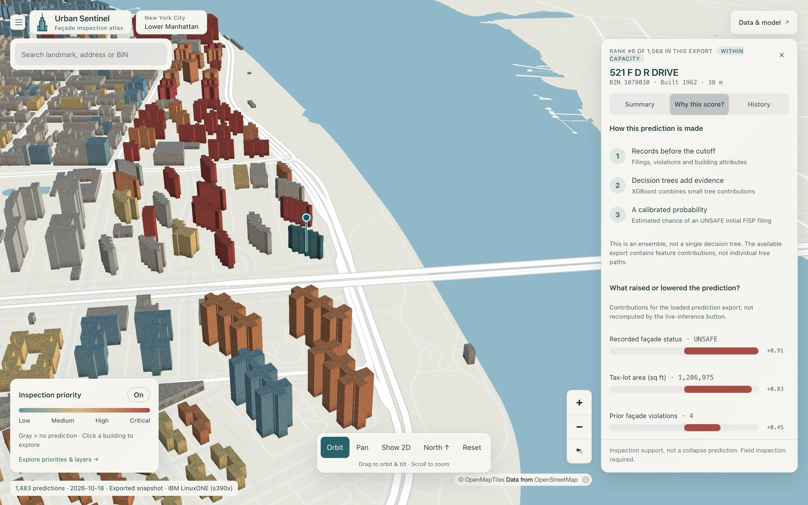
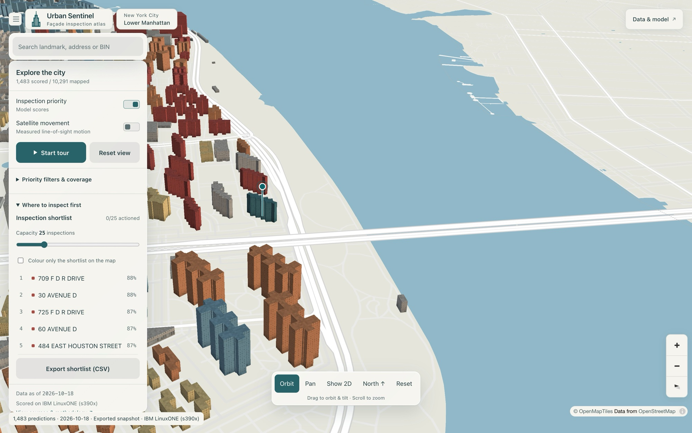

<h3 align="center">🚀 <a href="https://urban-sentinel-bay.vercel.app">Launch Urban Sentinel — interactive live demo</a></h3>

<h1 align="center">Urban Sentinel</h1>

<p align="center"><b>Predicting which New York City buildings need a façade inspection first</b><br>
IBM Z Datathon 2026 · Real-Time AI for Critical Decisions · Team Megatronn · Built on IBM LinuxONE</p>

<p align="center"><a href="https://urban-sentinel-bay.vercel.app"></a></p>

<p align="center"><a href="#does-it-work">Results</a> · <a href="#how-it-works">How it works</a> · <a href="#why-ibm-linuxone">Why IBM LinuxONE</a> · <a href="#try-it-locally">Run it locally</a></p>

> **Buildings are inspected every five years. Urban Sentinel helps inspectors know where to look in between.**

Urban Sentinel scores every building in NYC's façade inspection program with **the chance that its next inspection is rated UNSAFE**. The scores are trained on real city records, tested on inspections the model never saw, and computed on **IBM LinuxONE**, where live requests run on the IBM Z AI accelerator.

---

## The problem: five years between inspections

A façade is a building's outer wall. Under NYC's Local Law 11 (the Façade Inspection & Safety Program, FISP), every building taller than six stories must have its façade inspected **once every five years**. About **13,000 buildings** file each cycle, and **about 1 in 4 is rated UNSAFE**.

Between inspections, the city learns about problems mostly from complaints and violations, often after something has already fallen. In December 2019, architect Erica Tishman was killed by façade debris from 729 Seventh Avenue, a building with an open façade violation ([Commercial Observer](https://commercialobserver.com/2019/12/729-seventh-avenue-erica-tishman-construction-death/)).

The records that could warn us already exist: inspection history, violations and building data. The question is:

> **Which buildings should inspectors investigate first?**

## Our solution: from reactive to proactive

| Today | With Urban Sentinel |
|---|---|
| Inspections on a fixed five-year cycle | **Inspection priorities** that can be re-scored whenever new public records arrive |
| Records scattered across city datasets | One **AI prediction** per building, grounded in government records |
| Problems found after complaints or damage | **Explainable evidence**: the factors behind every score |
| Buildings handled one at a time | An **interactive 3D map** and an **inspection shortlist** sized to the team's capacity |

"Re-scored whenever new records arrive" means the pipeline can be re-run on fresh public data. We do not measure façades continuously, and automated citywide refresh is future work.

## Explore Urban Sentinel

<table>
<tr>
<td width="50%"><br><b>Every building, explained.</b> Click any building to see its predicted probability, its priority tier, a real aerial photo and its building facts.</td>
<td width="50%"><br><b>Why this score?</b> The factors that pushed each prediction up or down, from the model's own explanations (TreeSHAP).</td>
</tr>
<tr>
<td width="50%"><br><b>Where to inspect first.</b> Set the inspection capacity and get a ranked shortlist, downloadable as a CSV file.</td>
<td width="50%"><br><b>Ground motion from space.</b> NASA OPERA radar measurements of ground movement, shown as a separate map layer.</td>
</tr>
</table>

**Try this in the live demo**
1. Open the [live demo](https://urban-sentinel-bay.vercel.app) and drag to orbit the 3D map.
2. Search for a landmark, an address or a Building Identification Number (BIN), such as `Woolworth` or `1078030`.
3. Click a building and open **Why this score?** and **History**.
4. Open **Explore priorities & layers**, move the **Capacity** slider and watch the shortlist update. Switch on **Satellite movement**.
5. Press **Start tour** for a guided walkthrough.

The public demo runs entirely on the **real predictions exported from IBM LinuxONE** (the status bar reads *Exported snapshot · IBM LinuxONE (s390x)*). Two features need our private LinuxONE service and work only on the team's machines: **live recalculation on IBM Z** and **full violation and complaint history**. The public site says so where they appear, and shows the inspection filings saved with the predictions.

## Does it work?

We tested on what really happened. The model learned only from records before **21 February 2020**. We then compared its ranking with the ratings licensed inspectors recorded in the 2020–2025 cycle.

<picture>
  <source media="(prefers-color-scheme: dark)" srcset="ml/reports/figures/precision_at_500_dark.png">
  
</picture>

**Of the 500 buildings Urban Sentinel would inspect first, 66% were later rated UNSAFE**, against 55% when ranking by each building's last inspection result. That is **about 50 more UNSAFE façades found with the same 500 inspections**. It also beats the NYC Department of Buildings' published 2022 risk score (40%) and a random pick (26%). All four numbers come from the same 12,116 buildings, the ones every method scores.

- **It finds new problems, not just repeat offenders.** Among buildings rated SAFE last time, 38% of the 250 it ranks riskiest turned UNSAFE, about twice the 18% expected by chance ([chart](ml/reports/figures/previously_safe_light.png)).
- **Higher scores mean higher risk.** The top 10% of scores were rated UNSAFE 57% of the time; the bottom 10%, 7% ([chart](ml/reports/figures/cycle9_deciles_light.png)).
- **The same result on IBM Z.** Re-run on LinuxONE (s390x), the blind test gives 66.0% in the top 500 across all 13,327 buildings ([s390x report](ml/reports/linuxone/RESULTS.md)).

**What it predicts:** an officially recorded future inspection rating, not building collapse or certain physical danger. Unscored or low-scored buildings are not "safe".

<details>
<summary><b>How we kept it honest</b></summary>

- **No peeking at the future.** Every feature uses only records dated before the decision date, enforced by a hard check and unit tests. Three undated penalty fields would have inflated the results (PR-AUC 0.552 instead of 0.379), so they are excluded ([leakage audit](ml/reports/leakage_audit.json)).
- **Same buildings, same information.** Every method is compared on an identical set of buildings. DOB's 2022 score may already have seen some of these outcomes, which favours DOB, and it still ranks lower. In a matched-date test on later filings, the gap is wider: 68% vs 48% ([results](ml/reports/linuxone/RESULTS.md)).
- **Uncertainty reported.** Every comparison has a 95% confidence interval (CI). Against the last-inspection rule, the top-500 gain is +10.2 points (95% CI +5.0 to +14.8) on all 13,327 buildings.
- **Calibrated.** A predicted 30% means about 30 in 100 such buildings are rated UNSAFE.

Full tables: [`ml/reports/RESULTS.md`](ml/reports/RESULTS.md) · What each data source adds: [`ml/reports/ABLATION.md`](ml/reports/ABLATION.md)

</details>

## Built on real government data

No synthetic training data: every record comes from public, government-maintained datasets that their publishers keep updating.

| Source | Role |
|---|---|
| [DOB NOW: Façade Compliance Filings](https://data.cityofnewyork.us/d/xubg-57si): **87,379 filings**, cycles 6–10 | **Model:** the outcomes we predict, and each building's façade history |
| [DOB Violations](https://data.cityofnewyork.us/d/3h2n-5cm9) | **Model:** façade, filing and unsafe-building violations since 1998 |
| [DOB ECB Violations](https://data.cityofnewyork.us/d/6bgk-3dad) | **Model:** failure to maintain walls, façade report not filed, sidewalk sheds |
| [MapPLUTO](https://data.cityofnewyork.us/d/64uk-42ks) | **Model:** building age, floors, lot size and type. **Map:** building facts panel |
| [NYC Building Footprints](https://data.cityofnewyork.us/d/5zhs-2jue) | **Map:** building shapes for the 3D city |
| [NASA OPERA DISP-S1](https://www.earthdata.nasa.gov/data/projects/opera) radar ground motion (InSAR) | **Map layer:** measured ground movement over time. Tested in the model: no significant improvement, so it is not a model input |
| DOB complaints (311) | **Tested, not used:** it did not improve predictions. Shown in building history when the LinuxONE service is connected |
| [DOB FacadeRisk scores](https://github.com/NYCDOB/FacadeRisk) (2022) | **Benchmark only:** what we compare against |
| [NYS orthoimagery](https://gis.ny.gov/orthoimagery) · [Wikimedia Commons](https://commons.wikimedia.org) | **Map:** aerial photos of each building, and credited photos of named landmarks |

## How it works

<picture>
  <source media="(prefers-color-scheme: dark)" srcset="ml/reports/figures/architecture_dark.png">
  
</picture>

**NYC Open Data → feature engineering (Python, pandas) → XGBoost → IBM LinuxONE + Snap ML on the NNPA → FastAPI → React, MapLibre and deck.gl 3D map**

1. **Describe each building.** 73 features (façade history, violations, building traits) are computed using only records dated before the prediction date.
2. **Train and test.** Gradient-boosted trees (XGBoost) learn which combinations came before an UNSAFE rating, with probabilities calibrated by Platt scaling and explained with TreeSHAP.
3. **Score on IBM Z.** The trained model scores every building on LinuxONE. The scores are exported for the map, and served live through a FastAPI service.
4. **Serve fast.** Live requests run the same trees on IBM Snap ML on the NNPA accelerator. The accelerator speeds up inference; it does not change the model's accuracy.

## Why IBM LinuxONE

The whole machine-learning pipeline ran on **IBM LinuxONE (s390x)**: data preparation, training, evaluation, scoring and the live API.

- **The AI accelerator, verified.** The IBM Telum chip's **Neural Network Processing Assist (NNPA)** runs our model through IBM Snap ML and zDNN. Before switching it on, the service checks that its predictions match CPU XGBoost; the largest difference across all 13,650 buildings is **0.00000038**.
- **Real-time answers.** One building is scored in **0.12 ms on the NNPA vs 0.36 ms on the CPU: 2.9× faster** (model-only inference, median of 200 live requests). A full request, including gathering the building's latest records, takes about 86 ms. For large batches the CPU is faster, so the NNPA serves one-at-a-time live requests.
- **Secure by default.** The API listens only on the VM's local address and is reached through an SSH tunnel. No secrets are stored in the code.

<picture>
  <source media="(prefers-color-scheme: dark)" srcset="ml/reports/figures/nnpa_latency_dark.png">
  
</picture>

**Stack:** IBM LinuxONE · RHEL 9.8 · Podman · JupyterLab (`jupyterlab-image-s390x`) · Python · pandas · XGBoost · IBM Snap ML · zDNN · FastAPI

<details>
<summary><b>Evidence from the LinuxONE machine</b></summary>

What the running service reports (`GET /health` on the VM):

```json
"platform": { "machine": "s390x", "byteorder": "big", "platform": "Linux-5.14.0-687.58.1.el9_8.s390x-s390x-with-glibc2.39" },
"inference_engine": { "engine": "snapml-nnpa", "zdnn_version": "1.1.2", "tree_format": "zdnn_tensors",
                      "parity_rows": 500, "parity_max_abs_diff": 2.87e-07 }
```

- Raw evidence (run record, s390x evaluation, NNPA benchmark, live responses, timings): [`ml/reports/linuxone/`](ml/reports/linuxone/README.md)
- Deployment guide: [LinuxONE runbook](ml/deploy/linuxone/RUNBOOK.md)
- Executable notebooks for LinuxONE JupyterLab: [`ml/notebooks/`](ml/notebooks/README.md)

</details>

## Try it locally

```bash
git clone https://github.com/JdenLee/Urban-Sentinel.git
cd Urban-Sentinel/frontend && npm ci && npm run dev     # 3D map on the LinuxONE snapshot
npm run build                                           # production build
```

<details>
<summary><b>Live predictions and the ML pipeline</b></summary>

- **Live predictions** need access to the team's LinuxONE VM: open an SSH tunnel to port 8000, and the map switches to the live service, with **Run on LinuxONE** and full building history. Steps: [LinuxONE runbook](ml/deploy/linuxone/RUNBOOK.md) and [`frontend/LINUXONE_LIVE.md`](frontend/LINUXONE_LIVE.md).
- **ML pipeline** (laptop or LinuxONE, Python 3.12):

  ```bash
  pip install -r ml/requirements.txt
  cd ml && python -m pytest tests -q        # includes leakage guards and s390x parity
  python -m urban_sentinel.pipeline         # download → evaluate → train → score
  ```

- **Hosting:** the public demo is a static Vercel deploy. See [`frontend/README.md`](frontend/README.md#public-demo-vercel).

</details>

## Limitations and what's next

- **Decision support, not a replacement for inspectors.** It ranks buildings for review; a licensed professional must inspect.
- **It predicts recorded ratings.** Buildings that never file have no outcome to learn from. Some PLUTO facts are a 2026 snapshot (without them the model still beats the rule: PR-AUC 0.424).
- **The 3D map covers Lower Manhattan**; the model scores about 13,800 buildings citywide.
- **Next:** validation with NYC DOB inspectors, automated public-data refresh and re-scoring, richer building-condition data, and other cities with façade laws.

## Team and credits

**Team Megatronn:** Kason Lin, Jayden Lee, Aaron Munford, Tina Tran

| Folder | What's inside |
|---|---|
| [`ml/`](ml/README.md) | Data pipeline, model, evaluation, live service, LinuxONE setup, figures and evidence |
| [`ml/insar/`](ml/insar/README.md) | Satellite ground-motion processing |
| [`frontend/`](frontend/README.md) | 3D map (React, MapLibre, deck.gl) |

**IBM:** [IBM LinuxONE Community Cloud](https://linuxone.cloud.marist.edu), [IBM Snap ML](https://snapml.readthedocs.io), [zDNN](https://github.com/IBM/zDNN), [jupyterlab-image-s390x](https://github.com/linuxone-community-cloud/jupyter-lab-ml).

**Open source:** [pandas](https://pandas.pydata.org), [NumPy](https://numpy.org), [scikit-learn](https://scikit-learn.org), [XGBoost](https://xgboost.ai), [matplotlib](https://matplotlib.org), [opera-utils](https://github.com/opera-adt/opera-utils), [FastAPI](https://fastapi.tiangolo.com), [Uvicorn](https://www.uvicorn.org), [React](https://react.dev), [Vite](https://vitejs.dev), [MapLibre GL JS](https://maplibre.org), [deck.gl](https://deck.gl), [react-map-gl](https://visgl.github.io/react-map-gl), [Vitest](https://vitest.dev).

**Data:** NYC Open Data. Satellite data from NASA's Observational Products for End-Users from Remote Sensing Analysis (OPERA) project via the Alaska Satellite Facility DAAC. Aerial imagery: NYS ITS Geospatial Services. Landmark photos: Wikimedia Commons contributors, credited in the app. Basemap © [OpenFreeMap](https://openfreemap.org) / [OpenMapTiles](https://openmaptiles.org) / [OpenStreetMap](https://www.openstreetmap.org/copyright) contributors.

*Urban Sentinel is a decision-support tool: it ranks buildings for human review. Field inspection by a licensed professional is always required.*
