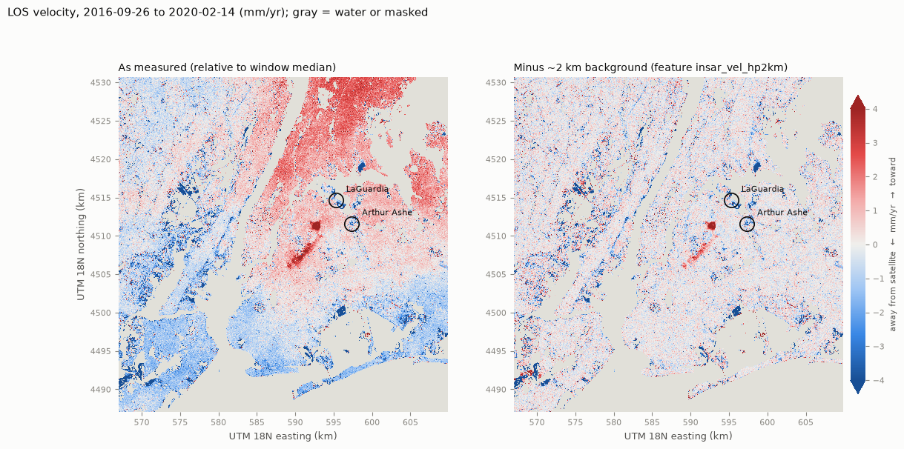
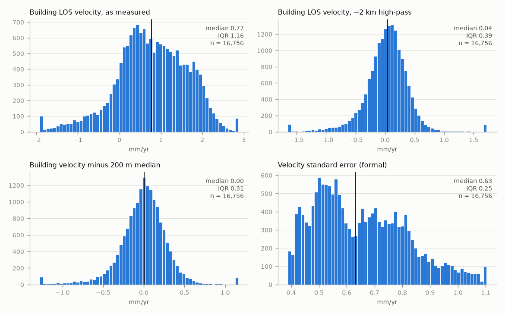
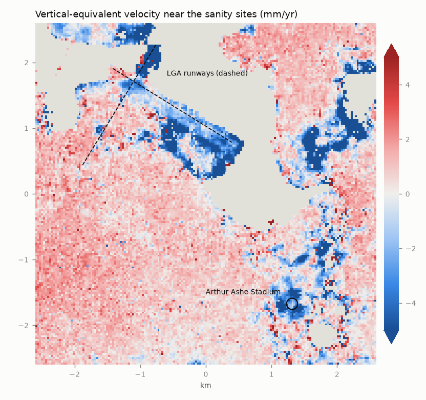
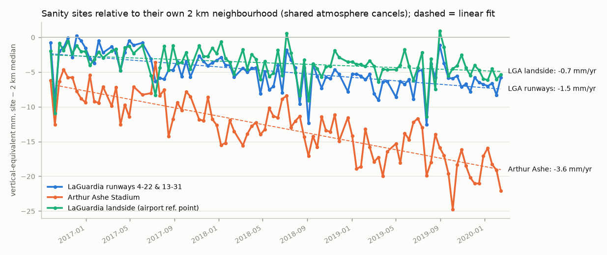

# InSAR quality report: OPERA DISP-S1 F08622, NYC window, cutoff 2020-02-21

Generated by `ml/insar/quality_report.py` from `build_features.py` outputs. All numbers use
only granules whose secondary (later) date is before 2020-02-21.

## Inputs
- Frame F08622 (Sentinel-1 ascending), 97 epochs, 2016-09-26 → 2020-02-14
  (time series starts at reference date 2016-07-16).
- Reference dates (ministacks): 2016-07-16, 2017-03-13, 2017-10-03, 2018-04-25, 2018-10-22, 2019-05-14, 2019-11-10.
- Crossover check: OK, every new reference date has a product ending on it.
  Explicit date-matched chaining agrees with `opera_utils` `rebase_timeseries` to
  0.0e+00 m on a 2,000-pixel sample.
- Window: 1454 × 1431 px of 30 m, 1,538,149 land pixels.

## Measurement quality
| metric | value |
|---|---|
| land pixels passing quality (recommended ≥ 70% of epochs, mean temporal coherence ≥ 0.5) | 1,375,120 (89.4% of land) |
| mean fraction of epochs with `recommended_mask` = 1 (land) | 93.7% |
| mean temporal coherence (land) | 0.885 |
| mean phase similarity (land) | 0.837 |
| persistent-scatterer fraction (land) | 8.1% |
| spatial reference pixels (≥ 95% recommended, coherence ≥ 0.7) | 1,284,209 |
| LOS up-component (median) | 0.792 (incidence ≈ 37.6°) |
| residual RMS about linear + annual model, median | 7.60 mm |
| formal velocity SE, median (white-noise assumption, optimistic) | 0.76 mm/yr |

## Velocity distribution (LOS, mm/yr, relative to window median)
p5 / p25 / p50 / p75 / p95
- Pixels: -2.48 / -0.79 / -0.01 / +0.80 / +2.22 (std 3.34, n = 1,375,120)
- FISP buildings: -0.73 / +0.24 / +0.77 / +1.40 / +2.06 (std 0.98, n = 16,756)
- Building minus 200 m neighbourhood median: -0.48 / -0.16 / +0.01 / +0.16 / +0.40
- FISP buildings, ~2 km high-pass: -0.58 / -0.16 / +0.04 / +0.23 / +0.52 (std 0.61)
- Buildings where |velocity| > 2 × formal SE: 27.1% as measured, 1.7% after the
  high-pass. The formal SE ignores temporally correlated atmospheric noise, so both overstate
  significance.

### Long-wavelength ramp (the main trap for the ablation)
A plane fitted to all good pixels has a gradient of +0.49 mm/yr per 10 km
east and +0.74 per 10 km north (≈ 5.4 mm/yr across the window).
That's far larger than any plausible real tilt of NYC. It's residual tropospheric or ionospheric
signal, plus a small plate-motion/LOS-geometry term (DISP-S1 v1 applies neither correction). As
measured, the building velocity therefore partly encodes **borough**:

| borough | median building velocity, as measured | median, ~2 km high-pass |
|---|---|---|
| Bronx | +1.70 | +0.08 |
| Brooklyn | +0.07 | +0.05 |
| Manhattan | +0.82 | +0.02 |
| Queens | +0.57 | +0.07 |
| Staten Island | -0.89 | +0.19 |

For the ablation, use the ramp-free columns: `insar_vel_hp2km_mm_yr`,
`insar_vel_diff_local_mm_yr`, `insar_vel_iqr_mm_yr` and the quality/noise columns. Don't use
raw `insar_vel_los_mm_yr` / `insar_vel_vert_mm_yr` unless borough is already controlled for.

### Confound check: correlation with building height (Spearman ρ)
Tall-building scatterers carry DEM-error, layover and thermal-expansion effects. If a feature
mostly tracks height, any "gain" in the ablation may just be height (likely already a model input).

| feature | ρ with `height_roof_ft` | n |
|---|---|---|
| `insar_vel_los_mm_yr` | -0.05 | 16,536 |
| `insar_vel_hp2km_mm_yr` | -0.10 | 16,536 |
| `insar_vel_diff_local_mm_yr` | -0.04 | 16,536 |
| `insar_seasonal_amp_mm` | +0.07 | 16,536 |
| `insar_resid_rms_mm` | -0.07 | 16,536 |
| `insar_dem_err_m` | -0.07 | 16,536 |
| `insar_ps_frac` | +0.09 | 16,536 |

## Coverage of the FISP universe
- 16,905 distinct FISP BINs; 16,779 located (footprint centroid or PLUTO lot);
  16,779 inside the window; **16,756 with InSAR features
  (99.1% of the universe, 99.9% of in-window BINs)**.
- By borough: Bronx 99.6% · Brooklyn 99.1% · Manhattan 98.9% · Queens 99.5% · Staten Island 98.6%.
- Buildings whose centroid pixel is flagged layover/shadow in the static layer: 0.9%.

## Sanity check against Buzzanga et al. (2023)
Published rates are vertical, GNSS-tied, and span 2016–2023. Ours are LOS / cos θ (assumes no
horizontal motion), span 2016–2020, and are relative to the NYC-window median, which absorbs
the regional ≈ −1.6 mm/yr (glacial isostatic adjustment). The fair comparison is
"published minus NYC mean" against "ours".

| site | ours, vertical (mm/yr) | ours minus 2 km median | published | published minus NYC mean (−1.6) |
|---|---|---|---|---|
| LaGuardia runways 4-22 & 13-31 | -1.10 (278 px, ±30 m) | -1.64 | -3.7 | -2.1 |
| Arthur Ashe Stadium | -3.08 (51 px, ±120 m) | -3.62 | -4.6 | -3.0 |
| LaGuardia landside (airport ref. point) | -0.22 (310 px, ±300 m) | -0.77 | n/a | n/a |

## Caveats
- 30 m pixels average many scatterers: features are block-scale, not façade-scale. With
  50 m sampling, a building's value is the median of ≈9 pixels shared with neighbours.
- LOS geometry: one ascending track; east-west motion and vertical motion are mixed. The
  vertical figures assume purely vertical motion.
- Tall buildings: layover and thermal expansion of high-rise façades (seasonal term) can
  dominate; Copernicus DEM geocoding of roof scatterers is approximate.
- No tropospheric correction (OPERA TROPO not applied). Re-referencing every epoch to the window
  median removes the common-mode part only.
- This is ground/structure motion, **not structural-safety evidence**. A null result in the
  ablation is the expected outcome.
